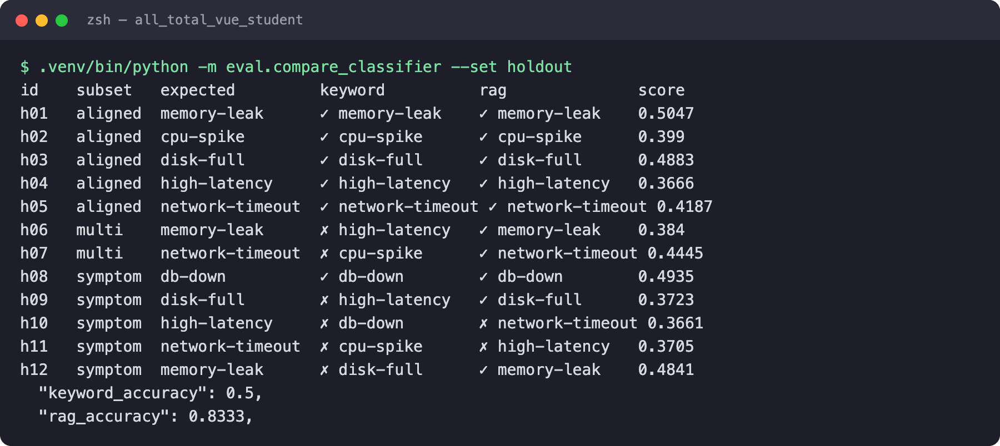
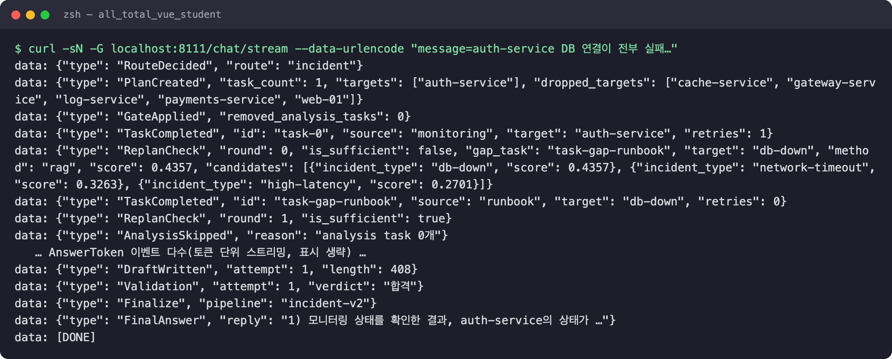
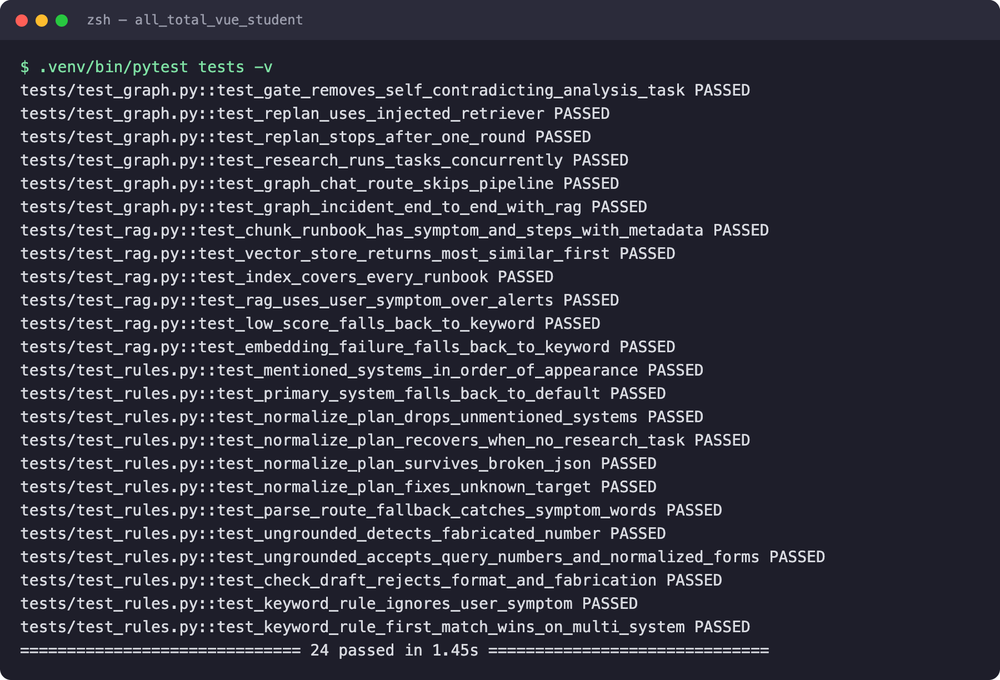
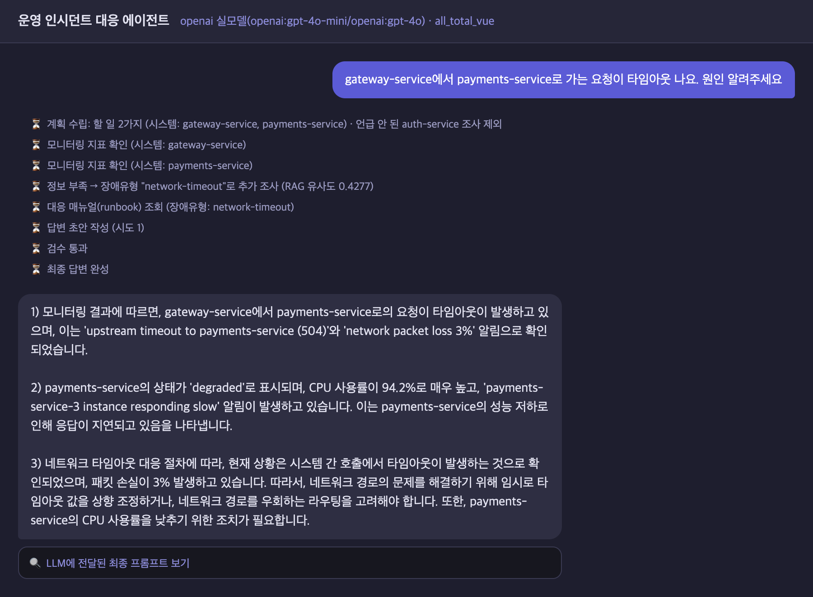
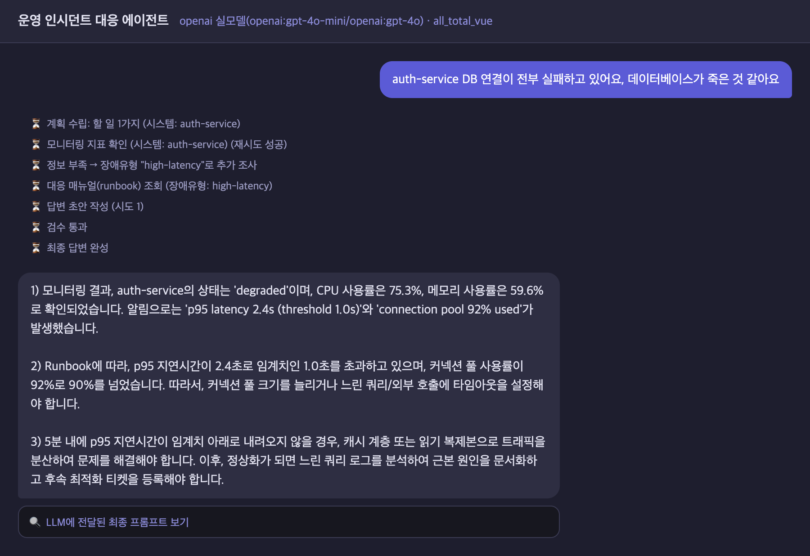
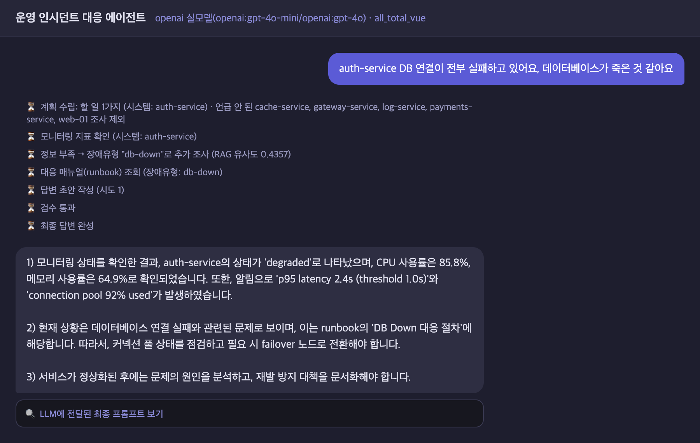
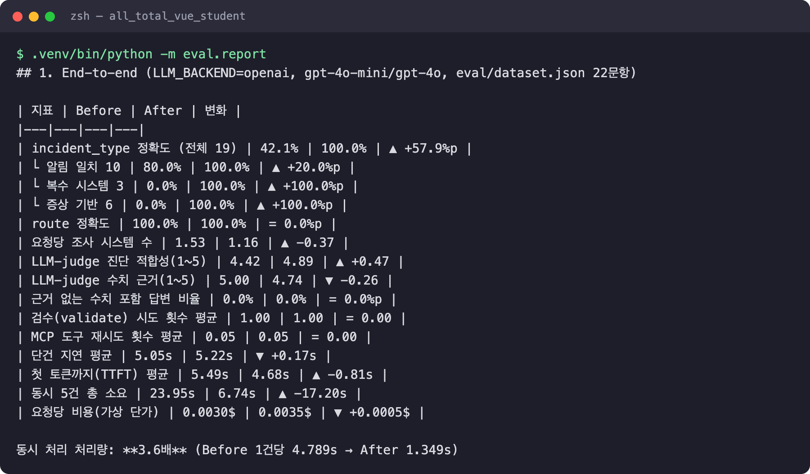
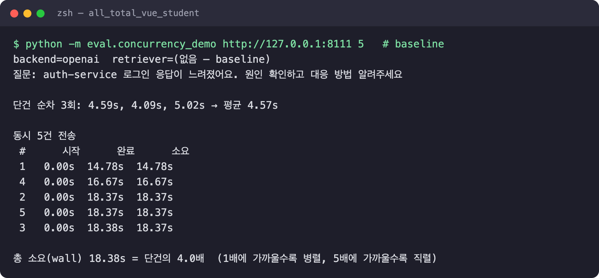
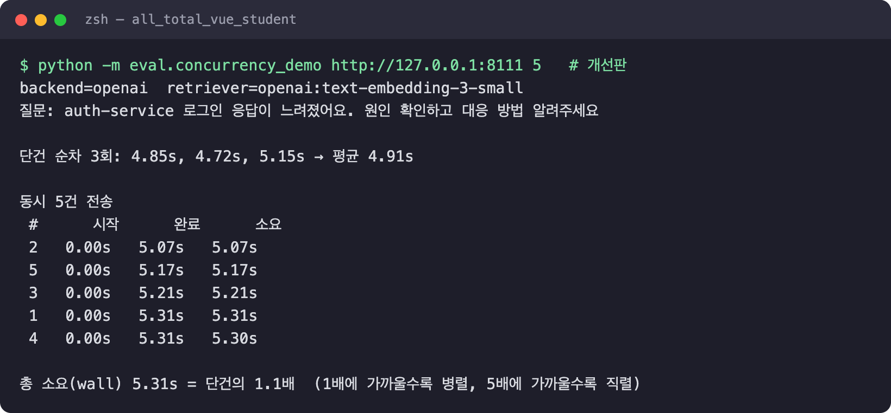

# AI Mini-Project 결과 보고서 — Base AI Agent 개선 (과제 1번)

광주 1반 · G007 · 나용성

> 순서는 공지된 최종 보고서 형식(주제 → 기능 개선·추가 포인트 → 사용 기술 요소 → Before/After → 한계·트레이드오프)을 따른다.
> 모든 수치는 `eval/results/*.json`에 원본이 있고 `python -m eval.report`로 재생성된다.
> Before = git tag `baseline`(원본 그대로), After = `main`. 화면 캡처는 `doc/presentation/captures/`.

## 1. 주제

**운영 인시던트 대응 에이전트**(`all_total_vue`) 개선. 사용자가 "auth-service DB가 죽은 것 같아요"처럼 장애를 물으면

1. MCP Tool `get_monitoring_status`로 해당 시스템의 지표·알림을 조회하고
2. 장애유형(incident_type)을 정해 MCP Resource `runbook://incident-response/{type}`으로 대응 매뉴얼을 읽고
3. 수집한 사실만 근거로 진단과 대응 절차를 1)~3) 형식으로 답한다.

FastAPI + LangGraph(`route → plan → gate → research ×N → replan_check → analysis → write → validate → finalize`), SSE로 진행 단계를 실시간 전달한다.

원본에서 찾은 약점:

| # | 약점 | 근거 (Before 실측) |
|---|---|---|
| P1 | incident_type을 **모니터링 알림 문구의 키워드 규칙**으로 결정. 사용자가 말한 증상은 보지 않고, 여러 시스템 알림이 섞이면 규칙 순서(latency→pool→cpu…)가 결과를 좌우하며, 매칭이 없으면 무조건 `db-down` | 분류 정확도 **42.1%** (복수 시스템 0%, 증상 기반 0%) |
| P2 | `openai_llm.py`가 async 노드 안에서 **동기 `httpx.post`** 호출 → 이벤트 루프 블로킹. `mcp_client.py`의 전역 `asyncio.Lock`도 모든 MCP 호출을 한 줄로 세움 | 동시 5건 **23.95s** ≈ 단건(4.79s) × 5 — 완전 직렬 |
| P3 | Plan이 쿼리에 없는 시스템까지 조사 (gateway 하나를 물었는데 6개 시스템 전부 조회) → 알림이 섞여 P1 오분류 유발 | 요청당 조사 시스템 **1.53개**, i08 오분류 |
| P4 | Validator가 "30자 이상 + `1)` 포함"만 확인 — 수치를 지어내도 합격 | — |
| P5 | `graph.py` 한 파일에 노드 10개, ollama/openai 백엔드에 plan 정규화·프롬프트 **복붙 중복**, 테스트·평가 코드 없음 | — |
| P6 | "스트리밍"이라고 하지만 OpenAI 백엔드는 완성된 응답을 한 번에 전달 | TTFT **5.49s** ≈ 전체 완료 5.50s |
| P7 | fake 백엔드 라우터 정규식이 "느려요/타임아웃/메모리"를 놓침 | fake route 정확도 **18.2%** |

## 2. 기능 개선 사항 및 추가 포인트

| 구분 | 영역 | 무엇을 바꿨나 | 결과 |
|---|---|---|---|
| 개선 ① | RAG 분류 (P1) | 키워드 규칙 → runbook 임베딩 의미 검색, 실패·저유사도 시 키워드 폴백 | 정확도 42.1% → 100% (holdout 50.0% → 83.3%) |
| 개선 ② | 동시성 (P2, P6) | `httpx.AsyncClient`, MCP 전역 Lock 제거, 실제 토큰 스트리밍 | 동시 5건 23.95s → 6.74s (3.6배), TTFT −0.81s |
| 개선 ③ | Plan 보정 (P3) | 쿼리에 언급 안 된 시스템 조사를 코드로 제거(`dropped_targets`) | 조사 시스템 1.53 → 1.16개 |
| 개선 ④ | 수치 근거 검증 (P4) | 초안 숫자가 요청·수집 사실에 없으면 반려 → 재작성 | LLM 호출 없음(비용 0) |
| 개선 ⑤ | 모듈화 (P5) | `graph.py` → `nodes/`·`rag/`, 백엔드 중복 → `llm_common.py` | 배선/구현 분리 |
| 추가 | 평가 하네스 | 원본·개선판을 같은 코드로 측정. holdout 12문항, LLM-judge, TTFT, 동시성 | `eval/` |
| 추가 | 단위 테스트 | stub 주입 24개, 1.4초, 네트워크 0 | 정규식 버그 1건 발견 |
| 추가 | 판단 근거 표시 | 웹 UI에 RAG 유사도·제외한 시스템·반려 사유 노출 | `web_chat.html` |
| 추가 | 데이터 보강 | runbook에 "대표 증상" 섹션 | RAG 검색 대상 텍스트 보강 |
| 추가 | fake 라우터 (P7) | 증상 단어 정규식 확장 | fake route 18.2% → 100% |

## 3. 사용한 기술 요소

| 기술 | 원본에 있던 것 | 개선·추가한 것 | 위치 |
|---|---|---|---|
| **Multi-Agent** | Supervisor(route) → Planner가 task를 `research`/`analysis` 에이전트에 배정 → Writer → Validator. 역할별 fast/quality 모델 분리 | research 워커 N개가 **실제로 동시 실행**되도록 async화, Planner 출력을 코드로 보정 | `agent/nodes/*` |
| **MCP** | Tool·Resource·Prompt 3종, stdio, `find_prompt`/`find_resource_template`로 서버 탐색(미끼 docs 서버 회피) | **전역 Lock 제거** — `ClientSession`이 JSON-RPC 요청 id로 응답을 짝지어 동시 호출 가능 | `agent/mcp_client.py` |
| **RAG** | 없음 (키워드 규칙) | **신규** — runbook 34청크 임베딩, 증상 0.75 + 알림 0.25 가중합, 폴백 | `agent/rag/` |
| **의존성 주입** | `SupervisorDeps` + `functools.partial` | `retriever` 주입, `create_deps` 팩토리, `RAG_ENABLED`·`RAG_EMBEDDER` 스위치, 테스트 stub 주입 | `agent/deps.py`, `server.py` |
| **LangSmith** | 노드별 `@traceable` | 검색 단계를 `@traceable(run_type="retriever")`로 추가, 후보 점수 기록 | `agent/rag/retriever.py` |
| **모듈화** | `graph.py` 한 파일, 프롬프트 복붙 3곳 | 배선만 남기고 `nodes/` 6 · `rag/` 4 · 공용 `llm_common.py` | `agent/` |
| **단위 테스트** | 없음 | **신규 24개** — 그래프 e2e, 병렬성, RAG 폴백 3경로, 회귀 | `tests/` |
| **스트리밍** | 완성된 답을 한 번에 전달 | OpenAI `stream=True` → 토큰 단위 SSE 중계 | `agent/openai_llm.py` |

### 3-1. RAG — `agent/rag/`

```
data/runbooks/*.md ──chunk──▶ [제목+대표증상] 1개 + [제목+절차 한 줄] N개   (metadata.incident_type = 파일명)
                               │ embed (text-embedding-3-small, 디스크 캐시)
                               ▼
                        InMemoryVectorStore (34 청크, 코사인 전수 탐색)
query(사용자 증상) ─embed─▶ 유형별 최고 유사도 ×0.75 ┐
알림(언급된 시스템)─embed─▶ 유형별 최고 유사도 ×0.25 ┴─▶ 1등 유형 (score < 0.25 또는 API 오류 → 키워드 규칙 폴백)
```

- **사용자 증상을 1순위 근거**로, 알림은 보조 근거로 쓴다. 원본은 증상을 아예 보지 않았다.
- `RunbookRetriever`는 `SupervisorDeps.retriever`로 **주입**된다. `RAG_ENABLED=0`이면 원본 키워드 규칙, `RAG_EMBEDDER=hash`면 네트워크 없는 결정론 임베딩(fake 백엔드·테스트용).
- 임베딩 API 장애나 낮은 유사도에서도 파이프라인이 멈추지 않도록 **키워드 규칙 폴백**을 남겼다(`method` 필드로 어떤 경로였는지 이벤트에 기록 → 웹 UI에 "RAG 유사도 0.4357" 표시).



*실행 캡처: 튜닝에 쓰지 않은 holdout 12문항, LLM 없이 분류기만 비교. 키워드 50.0% → RAG 83.3%.*

### 3-2. Multi-Agent · MCP · 스트리밍 — 이벤트로 남는 판단 근거

- **동시성**: 인스턴스당 `httpx.AsyncClient` 1개(커넥션 재사용)로 교체하고 route/plan/analyze를 전부 `async`로 바꿨다. MCP `ClientSession`은 요청 id로 응답을 짝지으므로 전역 Lock을 제거했다. write/chat은 `stream=True` SSE를 파싱해 **토큰이 생성되는 즉시** 프론트로 중계한다.
- **Plan 보정** (`llm_common.normalize_plan`): 쿼리에 시스템이 언급됐으면 그 밖의 target은 제거하고 `dropped_targets`로 남긴다. 모델 판단을 믿지 않고 코드가 보정한다는 원본 gate(W6) 원칙을 plan에도 적용했다.
- **수치 근거 검사** (`grounding.py`, `nodes/write.py`): 초안의 숫자(`2.4s`·`91%`)가 요청·수집 사실에 없으면 반려하고, 반려 사유에 그 숫자를 넣어 재작성시킨다. 최대 3회.



*실행 캡처: 개선판 `/chat/stream` 출력. AnswerToken 이벤트·각 줄의 `node` 필드·최종 답변 본문은 생략. PlanCreated의 `dropped_targets`, ReplanCheck의 RAG 점수·상위 3후보, MCP Tool(monitoring)·Resource(runbook) 조회가 보인다.*

### 3-3. 모듈화 · 의존성 주입 · 단위 테스트

```
agent/
├── graph.py            # 배선만 (노드 연결·조건 분기)
├── deps.py             # SupervisorDeps (mcp, llm, retriever …)
├── state.py            # AgentState + 비용 누적 헬퍼
├── systems.py          # 시스템 목록 단일 출처 (3곳 복붙 제거)
├── llm_common.py       # 프롬프트·route 파싱·plan 정규화 (ollama/openai 공용)
├── grounding.py        # 수치 근거 검사
├── nodes/{route,plan,research,replan,analysis,write}.py
└── rag/{embedder,vector_store,retriever,keyword}.py
```

`build_graph(deps)`가 `partial(fn, deps=deps)`로 모든 노드에 의존성을 주입한다. `tests/`는 `StubMCP`·fake LLM·`HashEmbedder`를 넣은 deps로 **subprocess·네트워크 없이** 그래프 전체를 돌린다. 원본 키워드 규칙의 알려진 한계도 회귀 테스트로 남겼다. 테스트 작성 중 "단위가 붙은 숫자(`3.7s`)를 추출하지 못하는" 정규식 버그를 발견해 수정했다.



### 3-4. 최종 실행 화면



*LLM_BACKEND=openai(gpt-4o-mini / gpt-4o). 질문에 나온 gateway·payments만 조사하고(auth-service 제외), 두 시스템 모니터링을 동시에 조회한 뒤, RAG가 network-timeout(0.4277)을 골라 해당 runbook으로 답했다. 원본은 같은 질문에 CPU 알림에 끌려 cpu-spike를 골랐다.*

## 4. Before / After 실측

### 4-1. 같은 입력, 화면 비교

질문: "auth-service DB 연결이 전부 실패하고 있어요, 데이터베이스가 죽은 것 같아요" (같은 OpenAI 모델·같은 MCP 서버, 코드만 다름)

| Before (baseline) — high-latency, 오답 | After (main) — db-down, RAG 0.4357 |
|---|---|
|  |  |

원본은 알림의 "p95 latency" 키워드가 먼저 걸려 지연 대응 절차(캐시·읽기 복제본)를 안내했다. 개선판은 사용자 증상으로 DB 장애 매뉴얼을 골라 failover 절차를 안내했다.

### 4-2. 평가셋 지표

(LLM_BACKEND=openai, fast=gpt-4o-mini / quality=gpt-4o, judge=gpt-4o-mini, `eval/dataset.json` 22문항)

| 지표 | Before | After | 변화 |
|---|---|---|---|
| **incident_type 정확도** (19) | 42.1% | **100.0%** | +57.9%p |
| └ 알림 일치 (10) | 80.0% | 100.0% | +20.0%p |
| └ 복수 시스템 (3) | 0.0% | 100.0% | +100%p |
| └ 증상 기반 (6) | 0.0% | 100.0% | +100%p |
| 요청당 조사 시스템 수 | 1.53 | 1.16 | −0.37 |
| LLM-judge 진단 적합성 (1~5) | 4.42 | **4.89** | +0.47 |
| LLM-judge 수치 근거 (1~5) | 5.00 | 4.74 | **−0.26** (5장 참고) |
| 근거 없는 수치 포함 답변 | 0.0% | 0.0% | = |
| 검수(validate) 시도 횟수 평균 | 1.00 | 1.00 | = (재작성 0건) |
| MCP 도구 재시도 횟수 평균 | 0.05 | 0.05 | = |
| 단건 지연 평균 | 5.05s | 5.22s | **+0.17s** |
| 첫 토큰까지 (TTFT) | 5.49s | **4.68s** | −0.81s |
| **동시 5건 총 소요** | 23.95s | **6.74s** | **처리량 3.6배** |
| 요청당 비용 (가상 단가) | $0.0030 | $0.0035 | **+$0.0005** |



**분류기 통제 실험** (같은 모니터링 입력, LLM 없음)

| 셋 | 키워드 규칙 | RAG |
|---|---|---|
| dataset (19) | 52.6% | 100.0% |
| **holdout (12, 튜닝 미사용)** | 50.0% | **83.3%** |
| └ holdout multi / symptom | 0% / 20% | 100% / 60% |

end-to-end Before(42.1%)가 통제 실험(52.6%)보다 낮은 이유는 P3(과잉 조사)로 무관한 시스템 알림이 섞였기 때문이다. 두 약점이 겹쳐 있었다.

### 4-3. 동시 요청 — HTTP 서버 전체 경유

`eval/concurrency_demo.py`: 떠 있는 서버의 `/chat`에 같은 질문 5건을 동시에 보낸다. 워밍업 1회는 측정에서 빼고, 단건은 순차 3회 평균이다.

| | 단건 평균 | 동시 5건 총 소요 | 단건 대비 |
|---|---|---|---|
| Before | 4.57s | 18.38s | 4.0배 (직렬) |
| After | 4.91s | **5.31s** | **1.1배** (병렬) |

| Before | After |
|---|---|
|  |  |

평가 하네스(그래프 직접 호출)의 23.95s → 6.74s(3.6배)와 같은 경향이다.

## 5. 한계와 트레이드오프

| 항목 | 내용 |
|---|---|
| 지연·비용 ↔ 정확도 | 임베딩 호출 1회(분류당 평균 260~390ms)로 **단건 지연 +0.17s**. runbook에 증상 섹션(유형당 약 100토큰)을 넣은 만큼 write 프롬프트가 길어져 **요청당 비용 +$0.0005(+17%)**. 임베딩 자체 비용은 쿼리당 약 $0.0000006으로 무시할 수준 |
| 평가셋 편향 | dataset 100%는 과대평가다. 평가셋·runbook 증상 문구를 같은 사람이 작성해 어휘가 겹친다. 의미를 모르는 **해시 임베딩도 dataset에서 100%**가 나온 것이 그 증거다. 그래서 holdout(83.3%)을 실제 성능에 더 가까운 값으로 본다 |
| RAG 실패 사례 | holdout h10 "web-01 페이지 로딩이 몇 배 느려졌어요"→network-timeout(정답 high-latency), h11 "외부 PG사 API 호출 시간 초과"→high-latency(정답 network-timeout). "느림"과 "시간 초과"가 임베딩 공간에서 가깝다. 두 건 모두 1·2등 점수 차가 0.01~0.02로 작았고, h10은 정답이 상위 3위 안에도 없었다(0.366 / 0.353 / 0.340). 점수 차가 작을 때 LLM이 **6개 유형 전체에서** 재판정하는 하이브리드가 다음 개선 후보다(1·2등 중 고르게 하면 h10은 못 고친다) |
| 임계값·가중치 | `min_score=0.25`, `query_weight=0.75`는 경험적으로 정했다. 문서가 늘면 재조정이 필요하고, 임계값이 너무 높으면 키워드 폴백이 잦아져 원본 성능으로 회귀한다 |
| LLM-judge 신뢰도 | grounding 하락(5.00→4.74)의 원인은 s03·s06 두 건이다. 둘 다 "모니터링 데이터엔 해당 수치가 없다"고 **정직하게 답한** 답변인데 judge가 감점했다. judge 자체가 오판할 수 있으므로 규칙 기반 지표(근거 없는 수치 비율)와 함께 본다 |
| 수치 근거 검사의 한계 | 문자열 매칭이라 단위 환산(2.4s↔2400ms)이나 계산값(평균·합계)을 "근거 없음"으로 오탐한다. 오탐이 나면 재작성이 일어나 비용이 늘지만, 최대 3회 후 통과 처리해 무한 루프는 막았다. 이번 평가셋에서는 Before도 근거 없는 수치가 0%여서 효과가 수치로 드러나지 않았다 |
| 동시성 | Lock 제거로 MCP 구간이 실제로 병렬화됐지만, stdio subprocess 1개를 공유하므로 MCP 서버 자체 처리량이 다음 병목이 된다. 동시 접속이 많아지면 서버 풀이나 HTTP 전송 방식이 필요하다 |
| 데이터 한계 | web-01 모니터링에 디스크 지표가 없어서, 유형을 맞혀도 답변에 실측 근거를 제시할 수 없다. 모니터링 스키마 확장이 필요하다 |
| 과잉 조사 차단의 부작용 | 언급되지 않은 연관 시스템(예: gateway 장애의 upstream)을 일부러 보고 싶은 경우까지 막는다. 의존성 그래프 기반 확장이 대안이다 |

### 다음 단계

1. 상위 점수 차가 작을 때 LLM이 전체 유형에서 재판정 (RAG + LLM 하이브리드)
2. 벡터 스토어를 Chroma/FAISS로 교체하고 runbook 수천 건 규모에서 지연 측정
3. 위험 조치(재시작·롤백) 제안 전 LangGraph `interrupt()`로 Human-in-the-loop 승인
4. LangSmith Dataset으로 eval 셋을 올려 실험 간 비교 자동화
5. 세션 이력 요약 압축 (현재 history는 무제한으로 누적)

## 부록 A. 진행 계획 (Google Spread 등록용)

| 순번 | 영역 | 무엇을 바꾸나 | 추가 설명 |
|---|---|---|---|
| 1 | RAG | 키워드 규칙 incident_type 매핑 → RAG | runbook을 증상/절차 청크로 임베딩(metadata=incident_type), 사용자 증상+알림으로 의미 검색. 실패·저유사도 시 키워드 규칙 폴백 |
| 2 | 모듈화 | graph.py 단일 파일 → `agent/nodes/*` | 배선(graph.py)과 노드 구현 분리, ollama/openai 중복 코드를 `llm_common.py`로 통합 |
| 3 | 동시성 | 동기 HTTP 호출·MCP 전역 Lock 제거 | async 노드 안의 동기 `httpx.post`가 이벤트 루프를 막아 동시 요청이 직렬화되던 문제 수정 + 실제 토큰 스트리밍 |
| 4 | 그래프 개선 | Plan 과잉 조사 차단 | 쿼리에 언급되지 않은 시스템을 조사하는 task를 코드 레벨로 제거 |
| 5 | 검증 | Validator에 수치 근거 검사 추가 | 수집된 사실에 없는 수치가 있으면 반려 → 재작성 |
| 6 | 평가 | 평가 하네스 + LLM-as-judge | Before/After 공통 하네스, 분류기 통제 실험, holdout 셋, judge(수치 근거·진단 적합성) |
| 7 | 테스트 | 단위 테스트 24개 | stub deps 주입으로 MCP·LLM 없이 그래프 end-to-end 검증 |
| 8 | 데이터 보강 | runbook에 "대표 증상" 섹션 추가 | RAG 검색 대상 텍스트 보강 |

## 부록 B. 재현 방법

```bash
bash sh/setup_venv.sh && cp .env.example .env   # OPENAI_API_KEY 입력
.venv/bin/pytest -q tests                       # 단위 테스트 (네트워크 불필요)
LLM_BACKEND=openai .venv/bin/python -m eval.run_eval --label after-openai
.venv/bin/python -m eval.compare_classifier --set holdout
.venv/bin/python -m eval.report                 # 비교표

# Before: 원본 코드로 같은 하네스 실행
git worktree add /tmp/baseline baseline && cp -r eval .env /tmp/baseline/
cd /tmp/baseline && LLM_BACKEND=openai <프로젝트>/.venv/bin/python -m eval.run_eval --label before-openai

# 동시 요청 시연 (서버가 떠 있는 상태에서)
.venv/bin/python -m eval.concurrency_demo http://127.0.0.1:8100 5

# 발표 화면 캡처 (pip install playwright, 설치된 Chrome 사용)
CAPTURE_URL=http://localhost:8600 .venv/bin/python doc/presentation/capture_web.py after "<질문>"
bash sh/make_pdf.sh                             # slides.html → PDF
```
